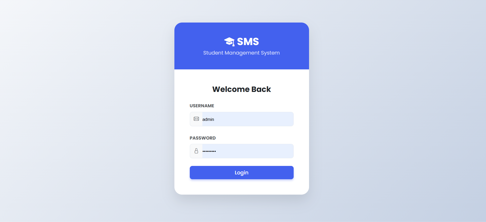
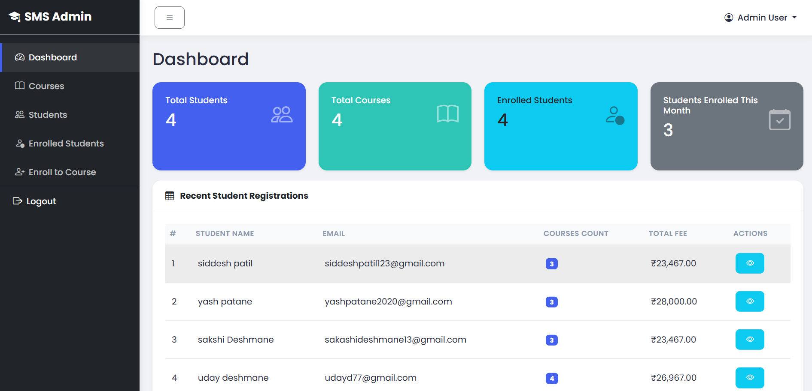
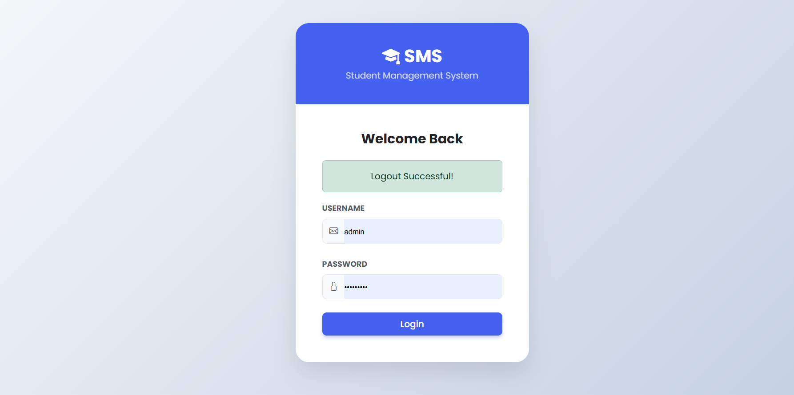

# Student Management System

A web-based Student Management System developed using **Java, Spring Boot, MySQL, Thymeleaf, HTML, CSS, and JavaScript**.

This application helps manage students, courses, and student enrollments through a simple and user-friendly interface.

## Features

- Admin Login and Logout
- Dashboard
- Add, View, Update and Delete Students
- Add, View, Update and Delete Courses
- Student Enrollment Management
- View Enrollment Details
- Form Validation
- Search and Pagination
- Database Integration using MySQL
- Responsive User Interface

## Technologies Used

| Technology | Purpose |
|---|---|
| Java | Backend Programming |
| Spring Boot | Backend Framework |
| Spring Data JPA | Database Operations |
| Hibernate | ORM |
| MySQL | Database |
| Thymeleaf | Template Engine |
| HTML | Page Structure |
| CSS | Styling |
| JavaScript | Frontend Interaction |
| Maven | Project Management |
| Git & GitHub | Version Control |

## Screenshots

### 1. Login Page


### 2. Dashboard



### 3. Student Management


### 4. Course Management


### 5. Enrollment Management


### 6. Logout


## Project Structure

```text
studentmanagement/
│
├── src/
│   ├── main/
│   │   ├── java/
│   │   │   └── com/
│   │   │       └── cwm/
