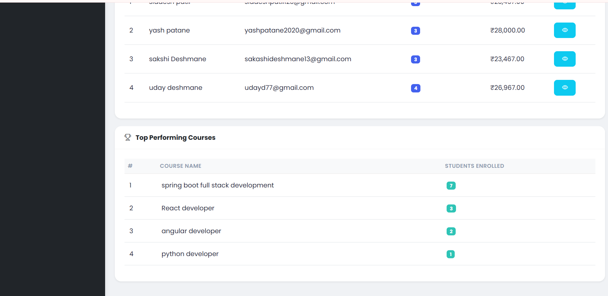
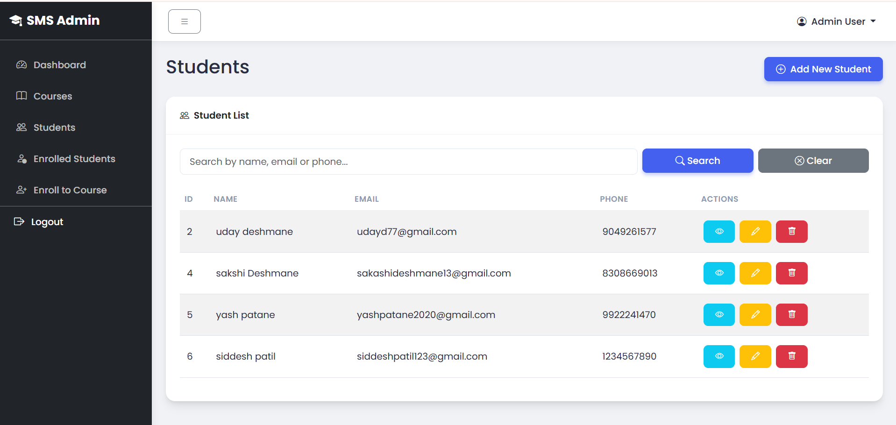
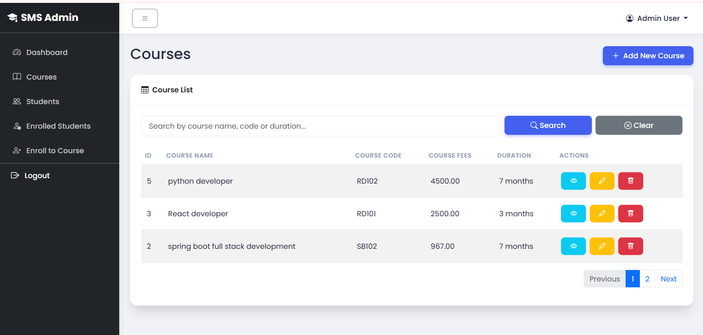

# Student Management System

A web-based Student Management System developed using **Java, Spring Boot, MySQL, Thymeleaf, HTML, CSS, and JavaScript**.

This application helps manage students, courses, and student enrollments through a simple and user-friendly interface.

## Features

- Admin Login and Logout
- Dashboard
- Add, View, Update and Delete Students
- Add, View, Update and Delete Courses
- Student Enrollment Management
- View Enrollment Details
- Form Validation
- Search and Pagination
- Database Integration using MySQL
- Responsive User Interface

## Technologies Used

| Technology | Purpose |
|---|---|
| Java | Backend Programming |
| Spring Boot | Backend Framework |
| Spring Data JPA | Database Operations |
| Hibernate | ORM |
| MySQL | Database |
| Thymeleaf | Template Engine |
| HTML | Page Structure |
| CSS | Styling |
| JavaScript | Frontend Interaction |
| Maven | Project Management |
| Git & GitHub | Version Control |

## Screenshots

### 1. Login Page


### 2. Dashboard




### 3. Student Management




### 4. Course Management




### 5. Enrollment Management


### 6. Logout


## Project Structure

```text
studentmanagement/
│
├── src/
│   ├── main/
│   │   ├── java/
│   │   │   └── com/
│   │   │       └── cwm/
│   │   │           └── studentmanagement/
│   │   │
│   │   └── resources/
│   │       ├── static/
│   │       │   ├── css/
│   │       │   ├── js/
│   │       │   └── images/
│   │       │
│   │       ├── templates/
│   │       └── application.properties
│   │
│   └── test/
│
├── screenshots/
├── .gitignore
├── pom.xml
└── README.md
```

## Requirements

Before running this project, install:

- Java JDK
- Maven
- MySQL Server
- VS Code or IntelliJ IDEA

## Database Configuration

First, create the database in MySQL:

```sql
CREATE DATABASE student_mgmt_db;
```

Configure your database credentials using environment variables.

### Windows PowerShell

```powershell
$env:DB_USERNAME="root"
$env:DB_PASSWORD="YOUR_MYSQL_PASSWORD"
```

Replace `YOUR_MYSQL_PASSWORD` with your own MySQL password.

**Important:** Never upload your actual database password to GitHub.

## How to Run the Project

### Step 1: Clone Repository

```bash
git clone https://github.com/sujaldeshmane11/StudentManagementSystem.git
```

### Step 2: Open Project Folder

```bash
cd StudentManagementSystem
```

### Step 3: Configure Database

Set your MySQL username and password as environment variables.

### Step 4: Run the Application

```bash
mvn spring-boot:run
```

### Step 5: Open in Browser

```text
http://localhost:8080
```

## Future Improvements

- Role-Based Authentication
- Email Notifications
- Advanced Search and Filtering
- Export Student Data
- Improved Dashboard Analytics

## Author

**Sujal Deshmane**

Java Full Stack Developer | MSc Computer Science Student

- GitHub: [sujaldeshmane11](https://github.com/sujaldeshmane11)

---

⭐ If you find this project useful, feel free to explore the repository and give it a star!